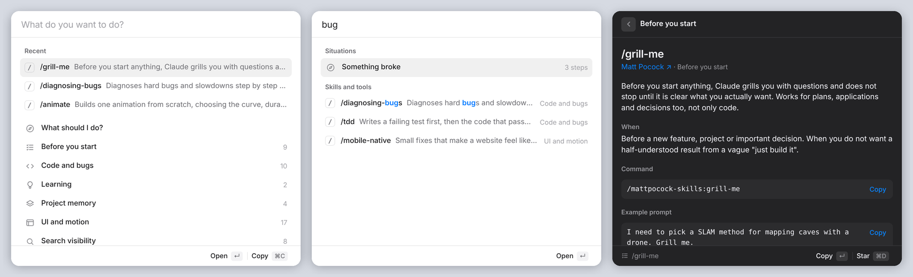

# Skillbar

**A desktop widget for your Claude Code skills, and a hand-picked set of skills worth installing.**

I installed a dozen Claude Code skill packs in one afternoon and then could not remember any of them. Which one do I use when something breaks? What was the command for the SEO audit? Skillbar is the answer I built for myself: a small macOS window that lives on the desktop, opens with a hotkey, and tells you which skill to use for what you are trying to do, with the command ready to copy.



**[Try the web demo →](https://gulheda.github.io/skillbar/)**

## What it does

- **Search by intent, not by name.** Type "bug", "launch", "paper" or "ship" and it shows the situation and the skills that fit it.
- **"What should I do?" playbooks.** 14 everyday situations (starting a project, something broke, about to ship, writing a thesis) with the skills to use in order.
- **92 skills and tools, explained.** What each one does, when to reach for it, the exact command, an example prompt and the gotchas.
- **Copy and paste into Claude Code.** Enter or ⌘C copies the command. Recent and starred skills stay at the top.
- **Lives on your desktop.** Sits behind your windows like a widget, stays put when you show the desktop, remembers where you placed it. Click away and it shrinks to a single search bar.
- **Keyboard first.** ⌥⇧Space from anywhere, ↑↓ to move, ↵ to open, esc to go back. Light and dark mode follow the system.

Native Swift (AppKit + WebKit), about 300 lines, no dependencies, nothing leaves your Mac.

## Install

Requires macOS 12 or later and the Xcode command line tools (`xcode-select --install`).

```bash
git clone https://github.com/gulheda/skillbar.git
cd skillbar
./build.sh
```

The script compiles the app, installs it to `~/Applications/Skillbar.app` and opens it. To start it at login: **System Settings → General → Login Items → +** and pick Skillbar.

| Shortcut | Action |
| --- | --- |
| ⌥ ⇧ Space | Show, expand, or hide |
| ↑ ↓ ↵ | Move and open |
| ⌘C / ↵ on a skill | Copy its command |
| ⌘D | Star |
| esc / ⌫ | Back, then shrink |
| ⌘W or red button | Close (menu bar icon brings it back) |
| green button | Shrink to a search bar |

Right-click the menu bar icon for *Keep above other windows*, *Reset position* and *Quit*.

## The skill set

These are the packs the catalog covers. Each one is someone else's work; Skillbar is just the map. Install the ones you want, Skillbar works fine with any subset.

| Pack | What you get | Install |
| --- | --- | --- |
| [Matt Pocock skills](https://github.com/mattpocock/skills) | Planning and engineering habits: `grill-me`, `tdd`, `diagnosing-bugs`, `code-review`, spec → tickets → implement | `claude plugin marketplace add mattpocock/skills`<br>`claude plugin install mattpocock-skills@mattpocock` |
| [Emil Kowalski skills](https://github.com/emilkowalski/skills) | UI and animation craft: `animate`, `review-animations`, `break-ui`, `mobile-native` | `npx skills@latest add emilkowalski/skills -g -a claude-code -s '*' -y` |
| [vibe-wise](https://github.com/nykooi1/vibe-wise) | Learning mode: Claude asks how you would do it before writing code | Anthropic plugin directory: `/plugin` → vibe-wise |
| [Graphify](https://github.com/Graphify-Labs/graphify) | Turns a project into a knowledge graph Claude can query | `uv tool install graphifyy && graphify install` |
| [Claude-Mem](https://github.com/thedotmack/claude-mem) | Memory across sessions, searchable history | `npx claude-mem install` |
| [Claude Code Setup](https://github.com/anthropics/claude-plugins-official) | Official: recommends hooks, skills and MCPs for your project | Anthropic plugin directory: `/plugin` → claude-code-setup |
| [Task Observer](https://github.com/rebelytics/one-skill-to-rule-them-all) | Learns from your corrections and proposes skill improvements | `claude plugin marketplace add rebelytics/one-skill-to-rule-them-all`<br>`claude plugin install task-observer@one-skill-to-rule-them-all` |
| [Claude SEO](https://github.com/AgriciDaniel/claude-seo) | SEO audits with parallel agents | `claude plugin marketplace add AgriciDaniel/claude-seo`<br>`claude plugin install claude-seo@agricidaniel-claude-seo` |
| [GEO SEO](https://github.com/zubair-trabzada/geo-seo-claude) | Visibility in ChatGPT, Perplexity and AI Overviews | `git clone https://github.com/zubair-trabzada/geo-seo-claude && cd geo-seo-claude && ./install.sh` |
| [Marketing Skills](https://github.com/coreyhaines31/marketingskills) | 53 skills: copy, ASO, launch, pricing, CRO | `claude plugin marketplace add coreyhaines31/marketingskills`<br>`claude plugin install marketing-skills@marketingskills` |
| [Strix](https://github.com/usestrix/strix) | AI pentesting that proves each finding | `npx skills@latest add usestrix/strix -g -a claude-code -s '*' -y` |
| [Academic Research Skills](https://github.com/Imbad0202/academic-research-skills) | Literature review, outlines, citation checks, referee-style review | `claude plugin marketplace add Imbad0202/academic-research-skills`<br>`claude plugin install academic-research-skills@academic-research-skills` |
| [Obsidian skills](https://github.com/kepano/obsidian-skills) | Obsidian Markdown, Bases, Canvas, clean web clipping | `claude plugin marketplace add kepano/obsidian-skills`<br>`claude plugin install obsidian@obsidian-skills` |
| [Video2Prompt](https://github.com/Zulelee/Video2Prompt) | Screen recording → implementation prompt | `git clone https://github.com/Zulelee/Video2Prompt && cd Video2Prompt && pip install -e .` |

The app also carries a few guides: a five-point security checklist before you ship, how to set up a `DESIGN.md`, how to use Claude with an Obsidian vault, and a short list of tools I looked at and decided not to install (and why).

If you are new to all this, start with four: `grill-me` before you build, `diagnosing-bugs` when it breaks, `vibe-wise:learn` when you are learning, `handoff` when a chat gets long.

## Make it yours

Everything the app shows lives in [`app/skills.js`](app/skills.js): categories, skills, situations and guides. Add your own entries, delete the packs you do not use, then run `./build.sh` again. Recents, stars and checklist ticks are stored locally.

The hotkey is set at the top of [`app/main.swift`](app/main.swift).

## Contributing

Found a great skill pack that belongs here, or a better example prompt? Open an issue or a PR against `app/skills.js`. Please keep entries short and written for someone who has never used the skill.

## License

MIT for Skillbar itself. The skill packs listed above belong to their authors and have their own licenses.

Made by [Gülheda Kızılhan](https://gulheda.com).
